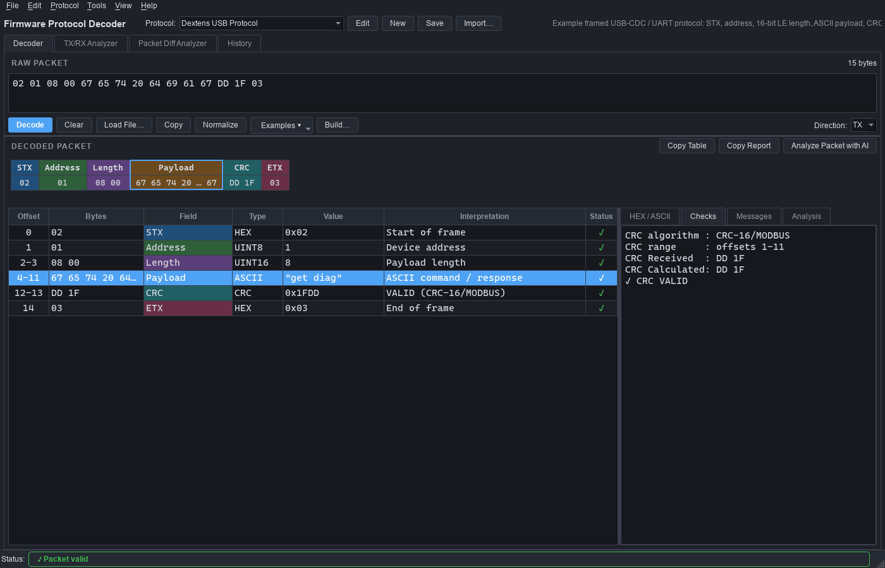
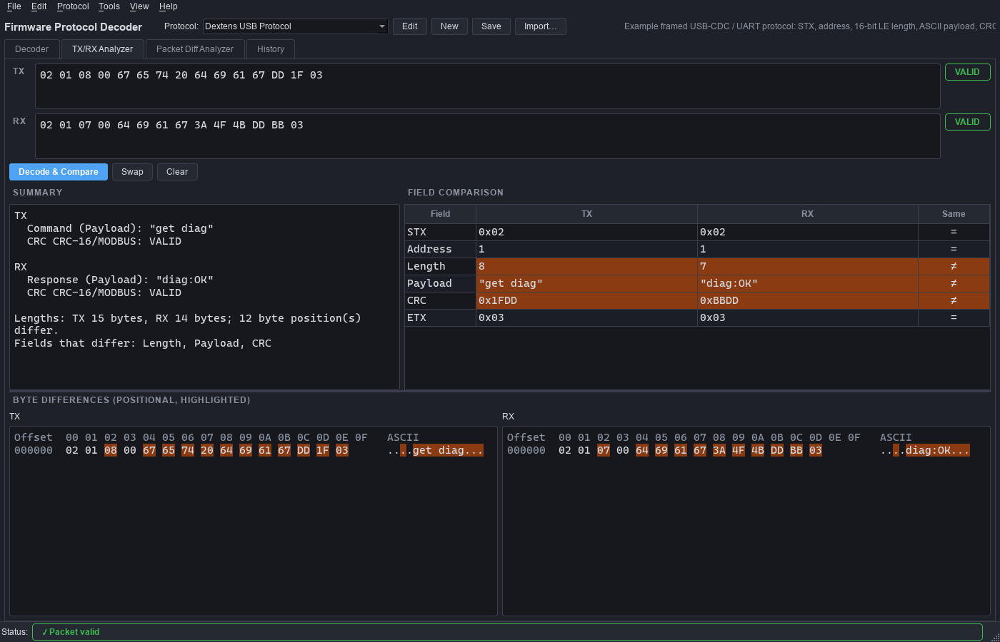
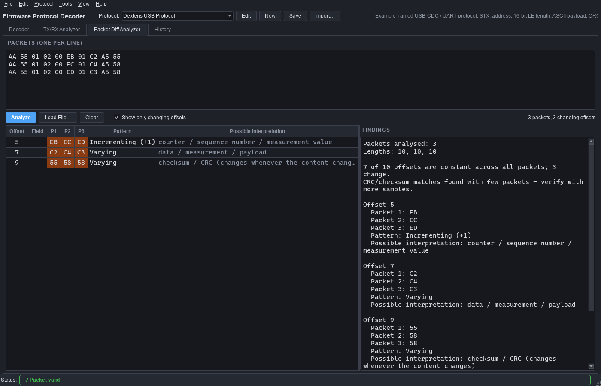

# Firmware Protocol Decoder

A desktop packet analyzer for embedded and firmware engineers. You describe a protocol once, in JSON or in the built-in editor, and the tool then decodes UART, USB-CDC, RS485, CAN payloads, Modbus or any custom binary frame. It shows every field, checks CRCs and checksums, and points out what is wrong.

- **Deterministic first.** Decoding is driven entirely by the protocol definition. Bytes that the definition does not describe are shown as **Unknown / Undefined**; the tool never invents meanings.
- **Offline.** No internet connection or AI service is needed. AI analysis is an optional add-on behind a small interface.
- **Cross-platform.** Python 3.11+ and PySide6; runs on Windows and Linux.



---

## Installation

```bash
cd protocol_decoder
python -m venv .venv
# Windows:  .venv\Scripts\activate
# Linux:    source .venv/bin/activate
pip install -r requirements.txt
```

The only runtime dependency is PySide6.

## Running

```bash
python main.py
```

On first launch, **Dextens USB Protocol** is selected and this packet is preloaded:

```
02 01 08 00 67 65 74 20 64 69 61 67 DD 1F 03
```

Click **Decode** (or press **Ctrl+Enter**):

| Offset | Bytes | Field | Value | Interpretation |
|---|---|---|---|---|
| 0 | 02 | STX | 0x02 | Start of frame |
| 1 | 01 | Address | 1 | Device address |
| 2-3 | 08 00 | Length | 8 | Payload length |
| 4-11 | 67 65 74 20 64 69 61 67 | Payload | "get diag" | ASCII command / response |
| 12-13 | DD 1F | CRC | 0x1FDD | VALID (CRC-16/MODBUS) |
| 14 | 03 | ETX | 0x03 | End of frame |

```
CRC Received  : DD 1F
CRC Calculated: DD 1F
✓ CRC VALID
```

> **Note on the reference packet.** The packet is 15 bytes long and `"get diag"` is 8 bytes, so the length field must be the two bytes `08 00`: a 16-bit little-endian value. The CRC `DD 1F` is **CRC-16/MODBUS over Address..Payload (offsets 1–11), sent low byte first**. This was found with the tool's own CRC search (*Tools → CRC / Checksum Calculator → Search CRC placement*) and is what the example definition uses.

---

## Main window

| Area | What it does |
|---|---|
| **Protocol bar** | Select a protocol; **Edit**, **New**, **Save** and **Import** definitions. |
| **Raw packet** | Paste HEX, drop a file, or pick a stored example. Shows a live byte count and HEX errors. |
| **Packet layout** | One coloured box per field, using the same colours as the table and the HEX view. Click a box to select its row. A red strip marks a field with errors. |
| **Decoded table** | Offset, bytes, field, type, value, interpretation and status. Bit fields appear as indented child rows. |
| **HEX / ASCII** | Side-by-side dump. Non-printable bytes show as `.`. The selected field is highlighted. |
| **Checks** | Received and calculated CRC/checksum, the covered byte range, and VALID / INVALID. |
| **Messages** | Every error and warning from the decoder. |
| **Analysis** | Output of *Analyze Packet with AI*. Inferences are labelled. |
| **Status bar** | ✓ valid, ⚠ valid with warnings, ✗ error (hover for details). |

Tabs: **Decoder**, **TX/RX Analyzer**, **Packet Diff Analyzer**, **History**. You can switch themes under *View → Dark/Light Theme*.

### Accepted HEX formats

Any of these, mixed freely and over multiple lines:

```
02 01 08 00          0x02 0x01 0x08       02,01,08,00
020108               02:01:08             \x02\x01\x08
02 01   # comments with # or //
```

Input is normalised before decoding. Invalid characters, an odd number of HEX digits, values that don't fit in a byte, and empty input are reported with the line and column. The application never crashes on bad input.

---

## Creating a protocol

Use **New** (Ctrl+N) or **Edit** (Ctrl+E) to open the protocol editor:

- **Definition tab:** set the name, description, default endianness, and optional frame start/end bytes. A start or end byte that doesn't match is reported as *Missing STX* / *Missing ETX*. Then build the field table with **Add / Edit / Delete Field** and **Move Up / Down**. Validation runs as you edit.
- **Field editor:** set the name, type, offset, length, endianness, text encoding, expected bytes, description, scale/bias/unit, value names, bit fields and CRC/checksum settings.
- **JSON tab:** shows the raw definition. Edit it and press *Apply JSON*.
- **Save Protocol** writes JSON. New protocols go to `protocols/user/`. Edited protocols are written back to their source file; use *Save As…* to keep the original.

### Supported data types

`hex`, `uint8/16/32/64`, `int8/16/32/64`, `float32`, `float64`, `ascii`, `utf8`, `binary`, `bitfield`, `bool`, `crc`, `checksum`.

Multi-byte types honour `"endian": "little" | "big"`. When a field doesn't set it, the protocol's `default_endian` applies.

```
Bytes 34 12   UINT16 little-endian = 0x1234 = 4660
              UINT16 big-endian    = 0x3412 = 13330
```

### Offsets and lengths (dynamic fields)

| Setting | Meaning |
|---|---|
| `"offset"` omitted / `"auto"` | Directly after the previous field (the usual case, including a CRC after a variable payload). |
| `"offset": 3` | Absolute byte offset. |
| `"offset": -2` | Counted from the end of the packet (`-1` is the last byte). |
| `"offset": "last"` | The field ends at the last byte (for example, ETX). |
| `"length": 4` | Fixed size. Defaults to the type size for numeric types. |
| `"length_from": "Length"` | Taken from an earlier integer field. `length = value × length_scale + length_adjust`. |
| `"length": "remaining"` | Everything up to the fixed-size fields that follow (for example, Modbus data before the CRC). |

### Bit fields

```json
{ "name": "Status", "type": "bitfield", "length": 1,
  "bits": [
    { "name": "Fault",  "start": 7, "length": 1, "description": "Sensor fault" },
    { "name": "Mode",   "start": 3, "length": 2, "values": { "0": "Idle", "1": "Normal" } },
    { "name": "Comm OK","start": 0, "length": 1 }
  ] }
```

Bit 0 is the least significant bit. Integer fields can carry `bits` too.

### Value names, scaling and expected bytes

```json
{ "name": "Function Code", "type": "uint8", "values": { "0x03": "Read Holding Registers" } }
{ "name": "Temperature",   "type": "int16", "scale": 0.1, "unit": "°C" }
{ "name": "Header",        "type": "hex", "length": 2, "expected": "AA55" }
```

A value missing from `values` is shown as *Undefined value N (not in definition)*.

### JSON schema (example)

```json
{
    "schema_version": 1,
    "name": "Dextens USB Protocol",
    "description": "Example framed USB-CDC protocol",
    "default_endian": "little",
    "frame": { "start_byte": "02", "end_byte": "03" },
    "fields": [
        { "name": "STX",     "type": "hex",   "offset": 0, "length": 1 },
        { "name": "Address", "type": "uint8" },
        { "name": "Length",  "type": "uint16", "endian": "little" },
        { "name": "Payload", "type": "ascii", "length_from": "Length" },
        { "name": "CRC",     "type": "crc", "length": 2, "endian": "little",
          "crc": { "algorithm": "CRC-16/MODBUS", "range_start": "Address", "range_end": "Payload" } },
        { "name": "ETX",     "type": "hex",   "offset": "last", "length": 1 }
    ],
    "examples": [
        { "name": "TX: get diag", "direction": "TX", "hex": "02 01 08 00 67 65 74 20 64 69 61 67 DD 1F 03" }
    ]
}
```

The schema is designed to grow. Unknown keys, at the top level or inside a field, are kept when the file is loaded and saved again. `schema_version` allows migrations later.

### Included examples (`protocols/examples/`)

| Protocol | Fields |
|---|---|
| **Dextens USB Protocol** (`dextens_usb.json`) | STX, Address, Length (u16 LE), ASCII Payload, CRC-16/MODBUS, ETX |
| **Modbus RTU** (`modbus_rtu.json`) | Slave Address, Function Code (named, including exceptions), Data, CRC |
| **Simple Sensor Packet** (`sensor_packet.json`) | Header AA55, Device ID, Temperature (0.1 °C), Humidity (0.1 %RH), Status bits, SUM-8 checksum |

Each protocol includes example packets, available from the **Examples ▾** button. Some of them are deliberately broken, for example a corrupted CRC or an oversized length field.

---

## CRC configuration

CRC fields use `"type": "crc"` plus a `crc` object:

```json
"crc": { "algorithm": "CRC-16/MODBUS", "range_start": "Address", "range_end": "Payload" }
```

- **Presets:** CRC-8, CRC-8/MAXIM, CRC-8/AUTOSAR, CRC-16 (ARC), CRC-16/CCITT (CCITT-FALSE), CRC-16/MODBUS, CRC-16/XMODEM, CRC-16/KERMIT, CRC-16/X-25, CRC-16/AUG-CCITT, CRC-16/USB, CRC-16/MAXIM, CRC-16/DNP, CRC-32, CRC-32C, CRC-32/MPEG-2. Every preset is checked against its standard check value in the unit tests.
- **Custom:** `"algorithm": "custom", "width": 16, "poly": "0x1021", "init": "0xFFFF", "xorout": "0x0000", "refin": false, "refout": false`. Overriding a parameter on a preset produces "*preset* (modified)".
- **Range:** a field name or a byte offset (negative counts from the end), inclusive. By default the range starts at offset 0 and ends at the byte before the CRC.
- **Byte order on the wire:** the field's `endian` setting.

**Checksums** use `"type": "checksum"` with `"checksum": {"algorithm": ...}`:

| Algorithm | Description |
|---|---|
| `xor8` | XOR of all bytes (LRC) |
| `sum8` | Byte sum mod 256 |
| `sum16` | Byte sum mod 65536 |
| `twos_complement8` | 8-bit checksum: sum + checksum = 0 (Intel HEX) |
| `ones_complement16` | 16-bit one's-complement word sum (RFC 1071) |
| `fletcher16` | Fletcher-16 |

**CRC / Checksum Calculator** (Ctrl+K) computes every preset and checksum for the current data, accepts fully custom parameters, and can **search the CRC placement** in an unknown packet. The search tries every preset, start offset and byte order, with 0–2 trailer bytes such as ETX.

---

## Loading packets

- **Load File…** (Ctrl+O) or drag and drop accepts `.txt`, `.hex`, `.log`, `.csv` and `.bin`.
- One packet is extracted per line. Timestamps (`12:32:10.123`, ISO dates, `[123.45]`) are ignored. In CSV files, the cell with the most HEX bytes is used. `TX`/`RX` words set the direction. Intel HEX data records are understood. A `.bin` file is loaded as one raw packet.
- When a file contains several packets, a picker lets you choose one. The Diff Analyzer loads all of them.

## TX / RX Analyzer

Paste a request and a response. **Decode & Compare** decodes both with the selected protocol and shows:

- **Summary:** text fields shown as *Command* (TX) and *Response* (RX), CRC status, errors, and which fields differ.
- **Field comparison:** field-by-field values, with differences highlighted.
- **Byte differences:** both HEX dumps with the differing positions highlighted.



## Packet Difference Analyzer

Enter two or more packets, one per line, or load a capture file. For every offset, the analyzer shows the values and classifies the pattern: *Constant*, *Incrementing (+1)*, *Decrementing*, *step +k*, *Alternating*, *Increasing/Decreasing*, *Varying*, or *Absent in some packets*. It also:

- detects 16- and 32-bit little- and big-endian counters that span adjacent bytes;
- **verifies CRC/checksum placements across all packets**, for example "*sum8 over offsets 0-8, stored at offset 9*". This is a computed fact, not a guess, but with few packets coincidental matches are possible and the tool says so;
- adds field names from the selected protocol, but only when packet 1 decodes cleanly with it.

Meanings are always labelled **"Possible interpretation"**. For example, an incrementing byte gives "*Possible interpretation: counter / sequence number / measurement value*".



## Packet Builder

**Build…** (Ctrl+B) asks only for the user fields, such as Address and Payload. It fills in frame bytes, length fields and CRC/checksum fields automatically. Values may be numbers, `0x..` values, value names (for example "Read Holding Registers"), or engineering values for scaled fields. This is built on `core/encoder.py`, which is also the basis for packet replay and test-sequence generation.

## History and export

Every decode (Decoder tab, TX/RX tab and live packets) is recorded with its time, direction, length, status, protocol, text summary and data. Double-click an entry to decode it again. Use **Clear History** and **Export History…** to save it as CSV:

```
Time,Direction,Length,Status,Protocol,Summary,Data
2026-10-19T12:32:10.123,TX,15,VALID,Dextens USB Protocol,"Payload=""get diag""",02 01 08 ...
```

## Error messages

The decoder reports problems instead of raising exceptions:

| Message | Cause |
|---|---|
| `Invalid HEX data` | Bad characters or digit count in the input. |
| `Packet shorter than expected` | A field runs past the end of the packet. |
| `Length field exceeds packet size` | A length field asks for more bytes than are present. |
| `CRC mismatch` / `Checksum mismatch` | Received and calculated values differ. |
| `Missing STX` / `Missing ETX` | Frame start or end byte is wrong. |
| `Unsupported field type` | The field type is not one of the supported types. |
| `Invalid protocol definition` | The definition fails validation. |
| `Packet longer than expected` / `undefined byte(s)` | Bytes not covered by any field. |

Malformed packets, including random garbage, are covered by the unit tests.

## Keyboard shortcuts

| Keys | Action |
|---|---|
| Ctrl+Enter | Decode (Analyze in the TX/RX and Diff tabs) |
| Ctrl+O | Open packet file |
| Ctrl+S | Save protocol |
| Ctrl+C | Copy selected data (table rows / text) |
| Ctrl+Shift+C | Copy the whole decoded table |
| Ctrl+L | Clear input |
| Ctrl+E / Ctrl+N | Edit / new protocol |
| Ctrl+B | Build packet |
| Ctrl+K | CRC / checksum calculator |
| Alt+1…4 | Switch tabs |
| F5 | Reload protocol files |
| F1 | Shortcut list |

---

## AI analysis (optional)

**Analyze Packet with AI** passes the finished decode to an analyzer. With no AI provider configured, the built-in **offline heuristic analyzer** is used. It produces a structured report: decoded fields and integrity, copied from the decoder, plus a few conservative inferences labelled *"Heuristic inference - not verified"* and *"Possible interpretation"*.

To add a real AI backend, without the decoder ever depending on it:

```python
# ai/my_backend.py
from ai.base import AIAnalyzer, AnalysisReport, AnalysisSection, AnalyzerUnavailable
from ai.prompt import SYSTEM_PROMPT, build_prompt

class MyLLMAnalyzer(AIAnalyzer):
    name = "My LLM"
    is_ai = True

    def is_available(self) -> bool:
        return True  # e.g. check an API key / local model

    def analyze(self, result, direction=""):
        prompt = build_prompt(result, direction)   # deterministic decode as ground truth
        answer = call_your_model(SYSTEM_PROMPT, prompt)
        report = AnalysisReport(self.name, is_ai=True)
        report.sections.append(AnalysisSection("Explanation", answer.splitlines(), inferred=True))
        return report
```

Register the class in `ai/__init__.py` (`ANALYZERS["my_llm"] = MyLLMAnalyzer`) and set `"ai_backend": "my_llm"` in `config/settings.json`. Backends that are unavailable fall back to the heuristic analyzer. AI output is always shown as **AI inference**; the decode table remains the source of truth.

## Live capture (future-ready)

`transport/base.py` defines `TransportInterface` with `open`, `close`, `write`, `is_open` and an RX callback. It also provides a `LoopbackTransport` used in the tests. `MainWindow.ingest_packet(data, direction)` is the hook that decodes a received packet and records it in the history. A serial, USB-CDC, CAN or TCP transport, plus a framer that splits a byte stream into packets, can be added without touching the decoder.

---

## Project structure

```
protocol_decoder/
├── main.py                  entry point
├── core/                    GUI-free decoding engine
│   ├── protocol.py          protocol model, JSON (de)serialisation, validation
│   ├── packet_parser.py     dynamic layout (offsets, length_from, remaining, last)
│   ├── field_decoder.py     per-type decoding, bit fields
│   ├── decoder.py           orchestration, frame/CRC checks, undefined regions
│   ├── encoder.py           build packets (auto length + CRC)
│   ├── crc.py               parameterised CRC engine, presets, CRC search
│   ├── checksum.py          XOR/SUM/8-bit/16-bit checksums
│   ├── comparison.py        TX/RX byte and field diff
│   ├── diff_analyzer.py     multi-packet pattern analysis
│   └── history.py           session history + CSV export
├── protocols/
│   ├── protocol_manager.py  load/save JSON definitions
│   ├── examples/            built-in example protocols
│   └── user/                your protocols
├── gui/                     PySide6 UI (main window, editor, views, dialogs, widgets/)
├── ai/                      optional analyzer interface, heuristic backend, prompt builder
├── transport/               TransportInterface for future live capture
├── utils/                   HEX/ASCII/file helpers
├── config/settings.json     theme, last protocol, default packet, AI backend
├── docs/                    design document (.docx), demo deck (.pptx), screenshots
└── tests/                   unit + GUI smoke tests
```

Core modules can be used headless:

```python
from protocols.protocol_manager import ProtocolManager
from core.decoder import decode_packet
from utils.hex_utils import parse_hex

m = ProtocolManager(); m.reload()
result = decode_packet(m.get("Dextens USB Protocol"), parse_hex("02 01 08 00 67 65 74 20 64 69 61 67 DD 1F 03"))
print(result.to_text())
```

## Running the tests

```bash
python -m unittest discover -s tests -t .
# or, if pytest is installed:
pytest
```

The tests cover HEX parsing, endianness, integer, float and text decoding, all CRC presets (standard check values), checksums, dynamic lengths, bit fields, invalid and garbage packets, the reference packet, the example files, the encoder, the diff analyzer, file extraction, history export, the AI interface and the transport. GUI smoke tests run headless using Qt's `offscreen` platform.

## Roadmap ideas

The architecture leaves room for live UART/USB/CAN capture, a CAN and Modbus analyzer, protocol auto-detection (decode against every definition and rank the results), AI-assisted protocol inference (seeded from the diff analyzer), firmware log analysis, packet replay, a HEX editor, and automated test-sequence generation (via the encoder).
